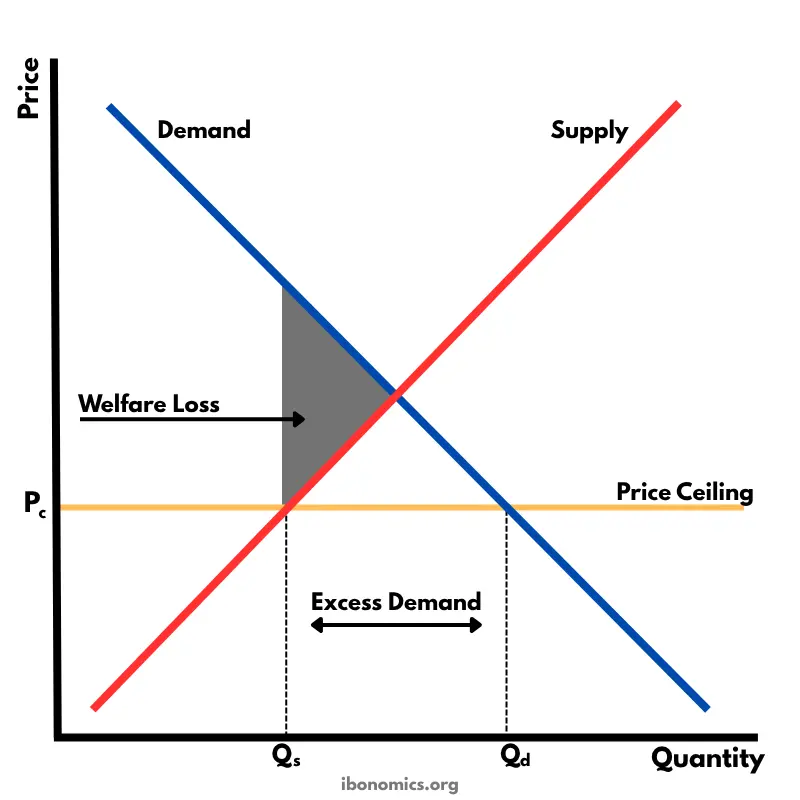

#  Government intervention
- What is Government intervention?
  > When the government artificially creates a market inequilibrium

## Functions of a government

- `Maintain law & order`
  - Create a stable environment for economic actors
- `Provide public goods/services`
  - Provide goods/services everyone needs (e.g: healthcare)
  - Makes sure no one is excluded because of the price
- `National defence`
  - Has to be done by the government, cannot be delegated away
- `Collect taxes`
  - Cover operating costs
- `Regulate labour markets`
  - Set local regulations for all actors
  - Set minimum wage
  - Protect workers' rights
- `Protect the environment`
  - Profit-oriented private sector --> Environmental damage --> Economic damage
- `Minimize inequality`
  - High inequality causes negative effects on economic growth
  - Reduce level of inequality in income and distribution
- `Reduce market failures`
  - Move market equilibrium artificially to what is socially desireable

## Aims of intervention
- Earn `revenue` 
- Support `firms` 
  - Small firms --> Establish themselves
  - `Encourage growth` of specific industries
- Support `households` 
- Influence level of `production output` (increase/decrease)
- Influence level of `consumption`
  - `Merit goods`: Encourage consumption of a good (pl: Education)
  - `Demerit goods`: Discourage consumption of a good (pl: Cigarettes)
- Correct `market failure`[^1]
  - To achieve social optimum
  - Tools: Taxes, subsidies, direct provision
- Promote equity
  - Market growth results in `unequal wealth distribution`
  - Government steps in and redistributes income

# Forms of intervention
- Price controls
- Taxes
- Subsidies
- Direct provision
- Command & control

## Price controls
- Setting `price floor` or `price ceiling` for products
- Causes `market disequilibrium` (shortage/surplus), that `market forces can not correct`

### Price ceiling (maximum price)
- Government sets a maximum price for a product
- Consequences:
  - `Creates shortages`
  - `Creates underground (black) markets`:
    - Markets where transactions are not recorded --> No tax revenue
    - Consumers who can pay more will be encouraged to use these markets
  - `Non-price rationing mechanisms:`
    - First come, first serve
    - Coupons
    - Favouritism
  - `Underallocation of resources`
    - Results in underproduction compared to the optimum
    - Society is worse off
- Usually a bad idea, but sounds good for `political campaigns`

- Consequences for stakeholders:
  - Consumers : Partly gain, partly lose
  - Producers : Worse off, sell less at lower price
  - Workers : Worse off, production firms likely to downsize (creates unemployment)
  - Government : Short term gain (popularity), long term loss (unemployment, less tax income)

- Are rental controls effective in areas of high demand for housing?
  - 

- Are there alternative policies which might be effective in improving affordability of housing --> Just build more houses bro

[^1]: When market optimum and social optimum differ (market produces too much or too little of a good compared to what would be socially desirable)