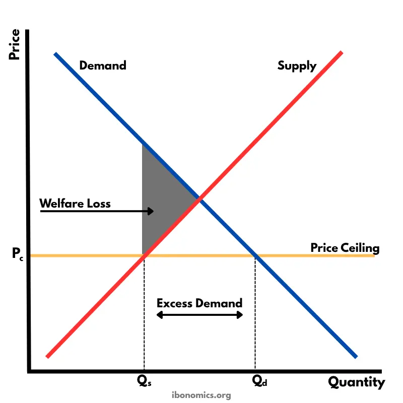

#  Price controls
- Setting `price floor` or `price ceiling` for products
- Causes `market disequilibrium` (shortage/surplus), that `market forces can not correct`

# Price ceiling (maximum price)
- Government sets a maximum price for a product
- Aim:
  - Allow lower-income consumers to buy the product
## Consequences:
  - `Creates a shortage`
  - `Creates underground (black) markets`:
    - Markets where transactions are not recorded --> No tax revenue
    - Consumers who can pay more will be encouraged to use these markets
  - `Non-price rationing mechanisms:`
    - First come, first serve
    - Coupons
    - Favouritism
  - `Underallocation of resources`
    - Results in underproduction compared to the optimum
    - Society is worse off --> welfare loss
- Usually a bad idea, but works well for `political campaigns`

- Consequences for stakeholders:
  - Consumers : Partly gain, partly lose
  - Producers : Worse off, sell less at lower price
  - Workers : Worse off, production firms likely to downsize (creates unemployment)
  - Government : Short term gain (popularity), long term loss (unemployment, less tax income)

#  Price floor (minimum price)
- Government sets a `minimum price` for a product
- Aim:
  - Provide protection for industry
## Consequences
- Creates a `surplus`
- Government has to `dispose of the surplus` by:
  - Storing (storage cost)
  - Export (at lower price)
- Incentivizes production
- Promotes `firm inefficiency`
- `Overallocation of resources`
    - Causes welfare loss
## Stakeholder consequences
- Consumers:
  - `Loss` --> Pay more for less
- Government:
  - `Loss` --> Less government funds, extra cost of storage
- Producers:
  - `Gain` --> Higher price, higher production --> `Total revenue increases`
  - Become protected against low-cost competition
- Workers:
  - `Gain` --> Employment increases
- Other countries:
  - Exporting surplus --> Lower global price
  - Lower global price --> Signal for lower production elsewhere
  - `Global misallocation of resources`
- Price floors cause `high-cost producers to produce more`, and `low-cost producers to produce less`

## Price floor on the labour market (minimum wage)
- Aim: Protect unskilled workers to ensure better standards of living
- Higher wage --> Lower demand for labour --> Labour surplus = unemployment (in theory)

## Case study: Does the minimum wage create unemployment
- Traditional belief among economists: Minimum wage causes unemployment
- 90% of countries have a minimum wage
- First to introduce minimum wage: New Zealand
- US federal minimum wage: 1938 (=> due to the great depression)
- Princeton study: New Jersey (increase in minimum wage) vs Pennsylvania (no increase)
  - Expectation: Higher unemployment in NJ
  - Findings: `The opposite` --> Higher employment in NJ than Penn
  - Why: 
    - Labour market `Monopsony`[^1] --> Only one opportunity for workers to work
    - Companies can offer wages `below market rate` --> Introduction of minimum wage didn't lead to redundancy, because wages were already below market rate
- Higher minimum wages --> Lower working hours per worker
- BUT Workers are able to find other jobs at the same time

[^1]: One buyer, many sellers

## Case study: Price floor to discourage alcohol overconsumption
### Problems:
- Alcohol is a demerit good that is also addictive --> Inelastic PED --> Higher price, small decline in Qd
  - Excessive drinking (=> Overconsumption):
    - High healthcare costs
    - Low productivity
  - Other:
    - Cheap supermarket alcohol puts british pubs at risk
### Introduction of a price floor
- Higher price --> Generally lower consumption for cheap alcohol
- Would have a `regressive effect`:
  - Low-income households would have to pay a higher fraction of their income for alcohol than higher-income families --> `Widening wealth gap`
- Alcohol is addictive, price-inelastic:
  - Change in price of alcohol --> only a small change in the quantity demanded
- Unintended possible conseequences:
  - Unregulated `moonshining`
  - Illegal alcohol imports
  - Finding substitutes (like cheaper drugs)
- Opportunity cost --> Healthcare costs
### Alternative measures
- Education for adults & children too
- Awareness campaigns (like for cigarettes)
- Excise duty (indirect tax)
- Restrictions on alcohol sales (e.g You can't buy alcohol after 10pm, you have to be 21, etc.)

### Advantages/Distadvantages
### Advantages
- Lower healthcare system load
- Higher productivity
- Government can target cheap alcohol specifically

### Disadvantages
- Government has to deal with the surplus alcohol
- Loss of tax-revenue for government
- Low-income families can be disproportionately affected
- People could begin using alternative substances
- The policy `cannot solve the root causes` --> Mental health issues, unemployment, economic hardship --> Government should try to treat these causes first
- Higher total revenue for alcohol producers
