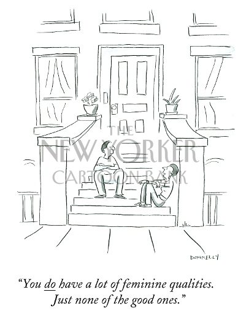

# Free choice group task

#
## People:
- We can see two men talking on the stairs in front of a house
- The picture is very symmetrical, using leading lines to draw the viewer's attention to the middle, where the two men sit

## Artist's technique:
- The cartoon is very symmetrical, using leading lines to draw the viewer's attention to the two people in the center

## Issue:
- The two men might be gay
- The artist suggest with the text that society pigeonholes feminine traits as either inherently good or bad, and places an expectation on partners/other people to only display and perform the "good" qualities

## Humor technique:
- The intonation of the speaker evokes humour

## Purpose
- Using two gay men (if they are) might highlight how they are a group of people who also have to deal with this same issue that was traditionally mainly an issue for women